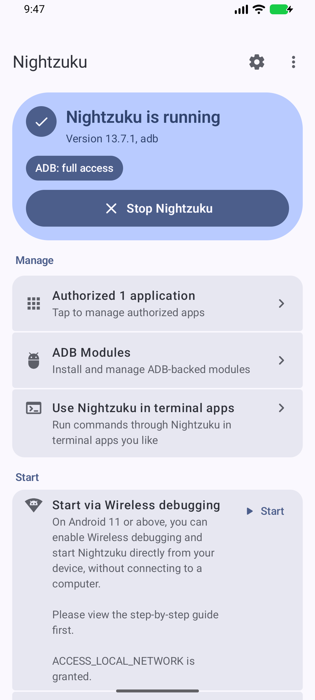
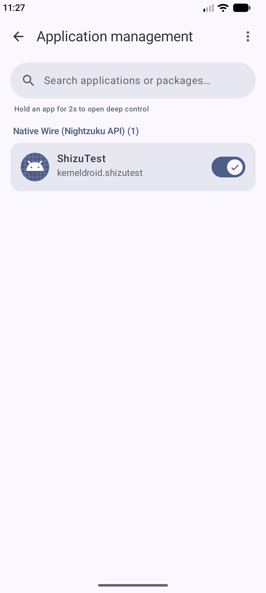
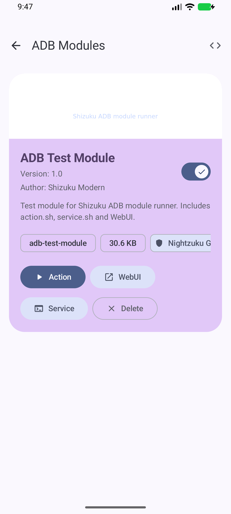
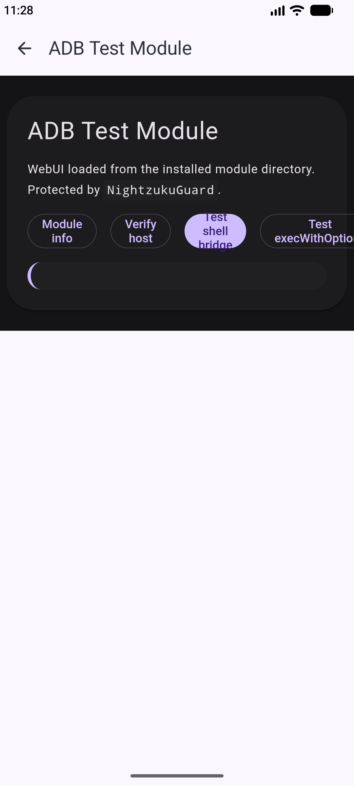
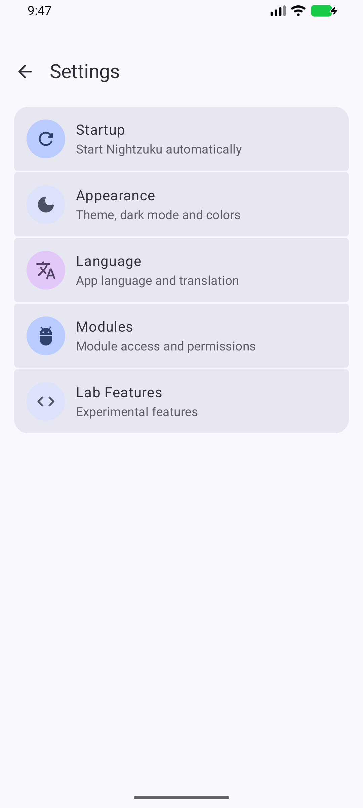
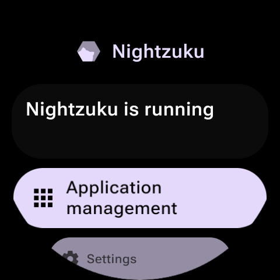
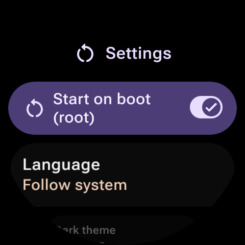
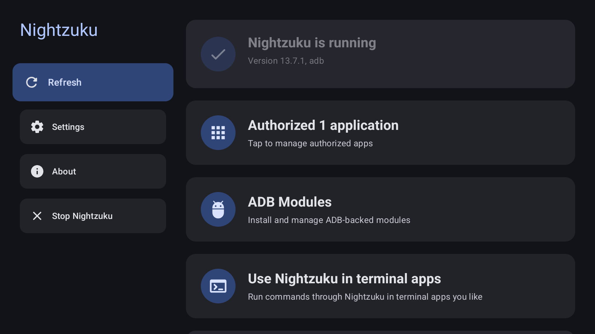
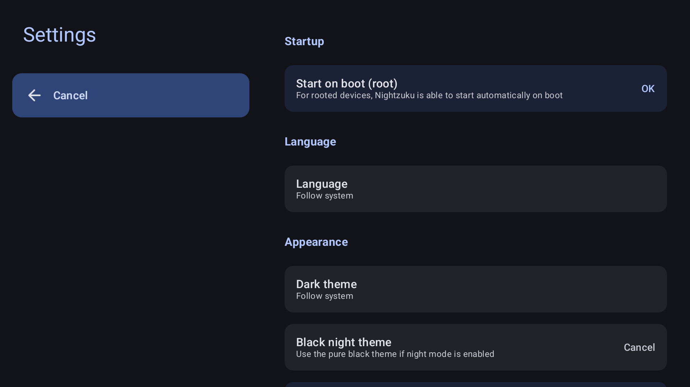

<p align="center">
  
</p>

# Yozuku

**日本語** | [English](README.en.md)

**Yozuku** は、kerneldroid による **Shizuku** のフォーク [Nightzuku](https://github.com/kerneldroid/Nightzuku) を、日本語化したものです。「Night（夜）」を日本語の「夜（Yo）」に置き換えて、Yozuku という表示名にしています。

Yozuku（`kerneldroid.nightzuku`）は、[Shizuku](https://github.com/RikkaApps/Shizuku) から派生した、Android の特権 Binder プロキシ兼モジュール実行環境です。ADB（`uid=2000`）または root（`uid=0`）の権限で、許可されたクライアントアプリに Android のシステム API を Binder IPC で直接提供します。`su` のシェルを起動するオーバーヘッドがありません。

> [!NOTE]
> このリポジトリ（[taketake5656/Yozuku](https://github.com/taketake5656/Yozuku)）は [kerneldroid/Nightzuku](https://github.com/kerneldroid/Nightzuku) のフォークで、アプリの日本語化を行っています。アプリの表示名は Yozuku ですが、パッケージ ID は Nightzuku と同じ `kerneldroid.nightzuku` のままです。署名が異なるため、kerneldroid 版の Nightzuku から上書きでインストールすることはできません。先にアンインストールしてください。

> [!NOTE]
> 上流の開発は [kerneldroid/Nightzuku](https://github.com/kerneldroid/Nightzuku) にまとめられています（`Nightzuku-private` はアーカイブ済み）。Yozuku はマージ後のマニフェストから `moe.shizuku.manager.permission.API_V23` を削除している（`tools:node="remove"`）ため、公式の Shizuku Manager と権限やオーソリティが競合せずに共存できます。

## アーキテクチャとモジュール

| モジュール | 言語 | 役割 |
| :--- | :--- | :--- |
| `:manager` | Kotlin / Jetpack Compose | Material 3 Expressive の UI（スマートフォン、Android TV、Wear OS）、ADB のペア設定、「セキュリティとアクセス」の設定、ADB モジュールの管理、スマートログの表示 |
| `:server` | Kotlin | 特権で動く `app_process` の Binder サーバー（`shizuku_server`）、2 系統の IPC、署名の固定、ユーザー・プロファイルの分離（`UserAccessPolicy`）、`Android17Compat` |
| `:common` | Kotlin | 共通の非公開 API の調査機能（`HiddenApiIntrospector`）、パッケージの署名の検証、ラベルの無害化、`SmartLogEngine` |
| `:nightdog` | Kotlin | サーバーのハートビートの監視（`NightDog`）と、システムサービスの停止の検知・再接続 |
| `rust/starter` | Rust | ネイティブのサーバーの監視（`libshizuku.so`）、プロセスの再起動、クラッシュ情報の保存 |
| `rust/adb-pairing` | Rust | ワイヤレス ADB のペア設定のネイティブライブラリ（`libadb.so`。TLS / SPAKE2 / HKDF / AES-GCM） |
| `rust/rish` | Rust | Shizuku / Nightzuku の Binder を使う対話型のリモートシェルのクライアント |

## 2 系統の IPC プロトコル

Yozuku は 2 つの Binder の経路を同時に動かし、`ClientRouting` でクライアントのパッケージごとに振り分けます。

| 経路 | インターフェース／権限 | 特徴 |
| :--- | :--- | :--- |
| **ネイティブ** | `kerneldroid.nightzuku.INightService`（`kerneldroid.nightzuku.permission.API`） | 単純な `Parcel` のトランザクション、UID ごとの機能のビットマスク、確認付きの `transactRemote`、1 回で済む `execFast`。サーバー側に `moe.shizuku.api` のスタブは不要 |
| **従来** | `moe.shizuku.server.IShizukuService`（`moe.shizuku.manager.permission.API_V23`） | 後方互換のある Shizuku の Binder の経路。**設定 → セキュリティとアクセス** でまとめて無効にできます |

`TransactGuard` は、`transactRemote` の呼び出しを転送する前に、宛先の Binder を確認し、UID ごとの機能のマスクを適用します。

## セキュリティと分離のモデル

| 制御 | しくみ | 既定の状態 |
| :--- | :--- | :--- |
| **証明書の固定** | SHA-256 による署名証明書の検証（Android 9 以降の `signingCertificateHistory` による鍵のローテーションの履歴にも対応）。マネージャー、クライアント、`UserService` のホストで行います | 常に有効 |
| **分離されたプロファイルの保護** | `UserAccessPolicy` が、Samsung Knox、セキュアフォルダ（`100–199`）、デュアルメッセンジャー（`95–96`）、Android 15 以降のプライベート スペース、OEM のクローンのプロファイル（`128`、`999`）を判別し、アプリの一覧の取得、一時的な許可リストへの追加、Binder の配布の対象から外します | 有効（ブロック） |
| **マルチユーザーの範囲** | **設定 → セキュリティとアクセス** で、プロファイルの種類（仕事用プロファイル、ほかのユーザー）ごと、ユーザー ID ごとにアクセスを設定できます（`BINDER_TRANSACTION_getSecurityPolicy` / `setSecurityPolicy` / `getDeviceUsers`） | メインユーザー（`0`）のみ |
| **Binder の配布範囲** | API を宣言したすべてのクライアントか、許可済みのアプリだけかを選べます（`binderDeliveryMode`） | API を宣言したすべてのアプリ |
| **アクセスの一時停止** | `accessPaused` で、マネージャー以外からの Binder、シェル、`UserService` のトランザクションをすぐに拒否します | オフ |
| **権限ダイアログの強化** | `setHideOverlayWindows`、タップの猶予時間、Unicode・双方向テキストを使ったラベルの無害化、UID を共有するパッケージの表示、要求の nonce の有効期間 5 分 | 常に有効 |
| **スマートログのフィルタ** | 層をまたいでクラッシュ・QPR・スターターのスナップショットを集めるエンジン。OS・HWUI・OEM の logcat の雑音を厳しく取り除きます（`SmartLogEngine.filterProcessLogcat`） | 有効 |
| **`app_process` のコマンドラインの拡張** | `LargeCommandTransport` と `ArgvTrampoline` が、Linux の `MAX_ARG_STRLEN` による 128 KiB の上限を、`app_process` と `sh -c` について `4 MiB` まで透過的に引き上げます。`getServerDiagnostics`（`maxAppProcessCmdlineBytes`、`supportsExtendedAppProcessCmdline`）で通知します | 有効 |

## 対応プラットフォーム

| プラットフォーム | UI | ADB モジュールとカタログ | セキュリティとアクセス |
| :--- | :--- | :--- | :--- |
| **スマートフォン / タブレット** | Jetpack Compose Material 3 Expressive | 対応（ローカルの ZIP、GitHub カタログ、仮想 HTTPS の WebUI） | 設定に専用の画面あり |
| **Android TV** | `androidx.tv.material3` | 対象外 | サーバー側で適用 |
| **Wear OS** | `androidx.wear.compose:compose-material3` | 対象外 | サーバー側で適用 |

## ドキュメント

| ドキュメント | 内容 |
| :--- | :--- |
| [ADB モジュール API](docs/adb-modules-api.md) | ZIP の形式、`module.prop` の項目、実行時の環境、`nightzuku-guard`、仮想 HTTPS の WebUI のブリッジ |
| [ADB モジュール ガイド](docs/adb-modules-guide.md) | 作成の流れ、最小限のモジュールのひな形、アクションとサービスのポリシー、安全のための制限 |
| [GitHub カタログ](docs/github-catalog.md) | `topic:adb-modules` による分散型の検索、トークンの暗号化、インストール方法、API の利用上限 |
| [NightDog のしくみ](docs/nightdog.md) | サーバーのウォッチドッグの状態遷移、`NightDogClient` による監視、`JobScheduler` によるアップデートの確認 |
| [Yozuku コネクタ](docs/nightzuku-connectors.md) | サードパーティの起動用アプリ向けのローカルの `ContentProvider`（`content://kerneldroid.nightzuku.connector`） |
| [Android 17 互換性](docs/android-17-compatibility.md) | 確認済みの非公開 API のシグネチャ（`IPermissionManager`、`IPackageManager`、`IUserManager`）と `Android17Compat` |
| [Android TV サポート](docs/android-tv-support.md) | TV 用の Compose の構成、十字キーのフォーカス、テーマ |
| [Wear OS 互換性](docs/wearos-compatibility.md) | ウォッチ向けのマニフェストの指定、Wear Material 3 のコンポーネント、SDK の互換性 |
| [Wear OS ペア設定ガイド](docs/wearos-pairing.md) | Wear OS 5 以降でのワイヤレス ADB のペア設定の手順と、トラブルシューティング |
| [ADB のループバック制限についてのメモ](docs/adb-loopback-restriction-memo.md) | 将来 `adbd` への localhost（`127.0.0.1`）接続が制限される可能性と、ループバックを使わない起動方法 |

## 開発者向けの情報とビルド

### クライアントへの組み込み

- 上流の Shizuku API とサンプル: <https://github.com/RikkaApps/Shizuku-API>
- ADB のシェルで使える権限は Android のリリースによって異なります。AOSP の `packages/Shell/AndroidManifest.xml` を確認し、実行時に `ShizukuService#getUid` / `checkPermission` で調べてください。
- Android 9 以降は、リフレクションによる非公開 API の利用が制限されています。必要に応じて、クライアントのプロセスで [AndroidHiddenApiBypass](https://github.com/LSPosed/AndroidHiddenApiBypass) を使ってください。
- `transactRemote` を直接呼び出す場合は、トランザクションのコードと引数の並びを、対象のプラットフォームの AIDL 定義と照らし合わせて確認してください。

### ソースからのビルド

ネイティブ部分は Rust で書かれているため、Android SDK・NDK に加えて次のものが必要です。

- [rustup](https://rustup.rs/)（stable の Rust）。Windows では Visual Studio Build Tools の「C++ によるデスクトップ開発」も必要です
- Android 向けターゲット: `rustup target add aarch64-linux-android armv7-linux-androideabi i686-linux-android x86_64-linux-android`
- [cargo-ndk](https://github.com/bbqsrc/cargo-ndk): `cargo install cargo-ndk --locked`

```sh
git clone --recurse-submodules https://github.com/taketake5656/Yozuku.git
cd Yozuku
./gradlew :manager:assembleDebug
```

単体テストの実行:

```sh
./gradlew :common:testDebugUnitTest :server:testDebugUnitTest
```

`:manager:assembleDebug` はデバッグ可能なサーバーを含めてパッケージにします。更新したサーバーのバイナリが確実に転送されるように、Android Studio で「Always install with package manager」を有効にしてください。

### リリース版のビルド（GitHub Actions）

`.github/workflows/release.yml` で、署名済みのリリース版をビルドできます。署名にはリポジトリの Secrets（`KEYSTORE`、`KEYSTORE_PASSWORD`、`KEYSTORE_ALIAS`、`KEYSTORE_ALIAS_PASSWORD`）を使用します。Secrets が未設定の場合はビルドが失敗します。

ワークフローは、次の 2 つの APK をビルドします（どちらも同じ鍵で署名します）。

- `nightzuku-<タグ>-release.apk`: 通常版（パッケージ ID `kerneldroid.nightzuku`）
- `nightzuku-<タグ>-stealth-<パッケージ ID>.apk`: ステルス版。パッケージ ID をビルドのたびにランダムな値（`com.xxxxxxxx.xxxxxxxx` の形）にしたもので、手動実行のときは入力欄 `stealth_id` で固定の値を指定することもできます。プロバイダのオーソリティ（`kerneldroid.nightzuku.*`）は通常版と同じなので、通常版と同時にはインストールできません

上流は、Shizuku のパッケージ ID（`moe.shizuku.privileged.api`）があるかどうかを確認するアプリ向けの互換スタブ（`nightzuku-stub-<タグ>.apk`）もビルドしますが、このフォークではビルドしません。スタブは上流の別リポジトリ [kerneldroid/nightzuku-stub](https://github.com/kerneldroid/nightzuku-stub) をビルドするもので、署名鍵を使う環境で外部のリポジトリをビルドすることになるのと、ライセンスの節で派生版に禁じているパッケージ ID を使うためです。必要な場合は上流のリリースのものを使ってください。

- **GitHub Release として公開する**: `v` で始まるタグを push します。ビルドした APK が添付されたリリースが自動で作成されます。

  ```sh
  git tag v13.7.1-ja1
  git push origin v13.7.1-ja1
  ```

- **ビルドだけ行う**: GitHub の Actions タブで「Release」ワークフローを選び、「Run workflow」から手動で実行します。APK は実行結果の Artifacts からダウンロードできます。デバッグ版だけが必要な場合は「App」ワークフローを使います。

## スクリーンショット

<details>
  <summary>スクリーンショット（エミュレーターで自動撮影）</summary>
  <br/>

  > [!NOTE]
  > これらのスクリーンショットは、[`.github/workflows/screenshots.yml`](.github/workflows/screenshots.yml) が Android 17、Wear OS 7、Android TV 16 のエミュレーターで自動で撮影したものです（英語表示）。`HEAD` より少し古いことがあります。

  ### スマートフォン
  <table>
    <tr>
      <td align="center"><br/><b>メイン</b></td>
      <td align="center"><br/><b>許可済みアプリ</b></td>
    </tr>
    <tr>
      <td align="center"><br/><b>ADB モジュール</b></td>
      <td align="center"><br/><b>モジュール WebUI</b></td>
    </tr>
    <tr>
      <td colspan="2" align="center"><br/><b>設定</b></td>
    </tr>
  </table>

  ### Wear OS
  <table>
    <tr>
      <td align="center"><br/><b>メイン</b></td>
      <td align="center"><br/><b>設定</b></td>
    </tr>
  </table>

  ### Android TV
  <table>
    <tr>
      <td colspan="2" align="center"><br/><b>メイン</b></td>
    </tr>
    <tr>
      <td colspan="2" align="center"><br/><b>設定</b></td>
    </tr>
  </table>
</details>

## ライセンスと名称の制限

**Apache License 2.0**（`LICENSE`）で公開しています。

- **ランチャーのアイコン**: `manager/src/main/res/mipmap*/ic_launcher*.png` は、Yozuku を表す目的にのみ使用できます。
- **パッケージの名称と ID**: 派生物では、`Shizuku` という名前や、アプリケーション ID `moe.shizuku.privileged.api` を使用できません。このフォークは `kerneldroid.nightzuku` を使っています。

## クレジット

- [RikkaApps/Shizuku](https://github.com/RikkaApps/Shizuku) — 上流のアーキテクチャとプロトコル
- [Razgame](https://github.com/RazGame/Shizuku) — [アプリ一覧の修正](https://github.com/kerneldroid/Nightzuku/commit/6ea7e74984f860398760f5111a15083ea004c842)
- [Porter（d4rken-org）](https://github.com/d4rken-org/porter) — セキュリティ強化のアイデア（パッケージの署名の検証、設定ファイルの所有権の受け渡し、権限の要求のなりすまし対策、ワイヤレス ADB／mDNS の境界条件の分析）。Nightzuku 向けに独自に作り直しています
